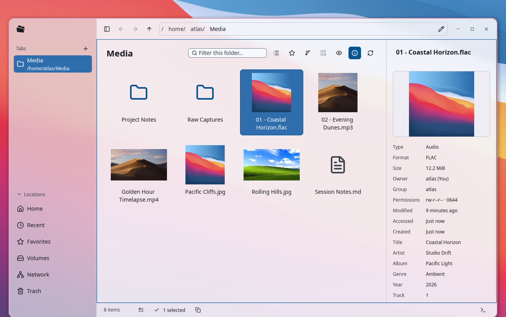
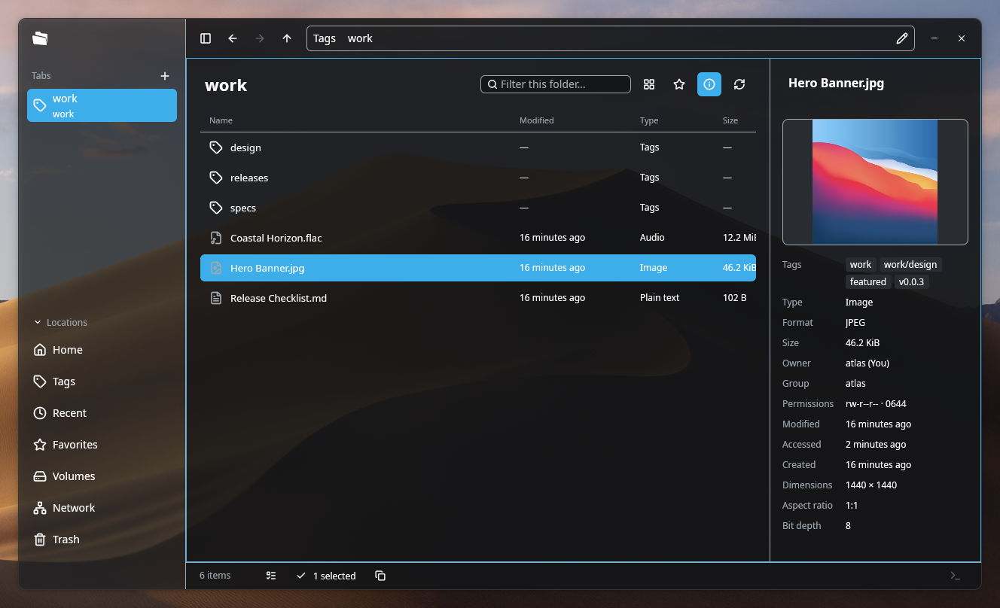
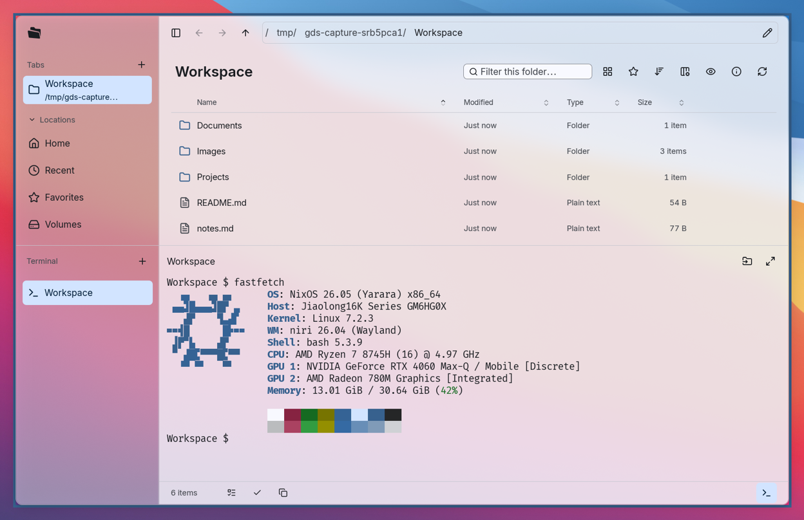
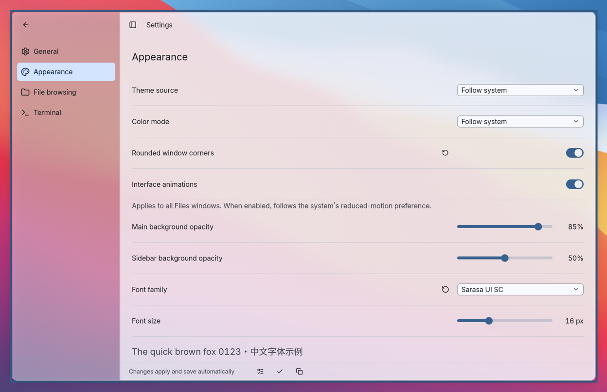
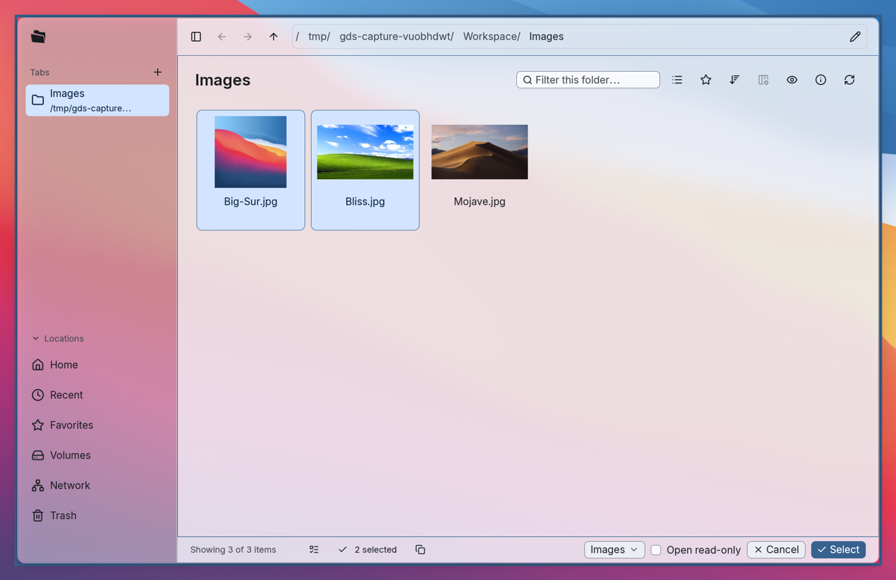

# GDS Files

GDS Files is an open-source native file manager for Linux and Wayland, built in Rust with GPUI and GPUI Kit. It pairs familiar desktop file browsing with translucent surfaces, live desktop theme synchronization, keyboard-driven navigation, and an integrated terminal.

## Everyday browsing and media inspection

Switch between grid and list views, open multiple folders in sidebar tabs, filter the active directory as you type, and jump across locations such as Home, Recent, Favorites, Volumes, Network, and Trash. An optional details panel previews images, embedded album artwork, and file attributes including permissions, image dimensions, and audio tags.

## Hierarchical file tags

Organize files across directories using nested tags and browse them from the sidebar like virtual folders. Each item can carry multiple tags, making project assets and cross-folder collections easy to group and revisit without moving files on disk.

## Integrated workspace terminal

Open a terminal pane directly inside the file manager window, synchronized with your workspace and listed alongside open tabs in the sidebar. Run quick tools, inspect repositories, or manage files from the keyboard without switching windows.

## Native Wayland appearance and desktop integration

GDS Files adapts live to system color palettes and light or dark preferences across Noctalia, DankMaterialShell, KDE Plasma, and GNOME, including wallpaper-derived themes. Independent opacity sliders let you tune main area and sidebar translucency separately alongside rounded window corners, interface animations, font family, and text size.

When paired with its optional XDG Desktop Portal backend, other desktop applications can also use GDS Files as their native open and save file dialog with file-type filters, multi-selection, and read-only selection support.

GDS Files is under active early development and is licensed under Apache-2.0.

[GitHub repository](https://github.com/GanDesktop/gds)
